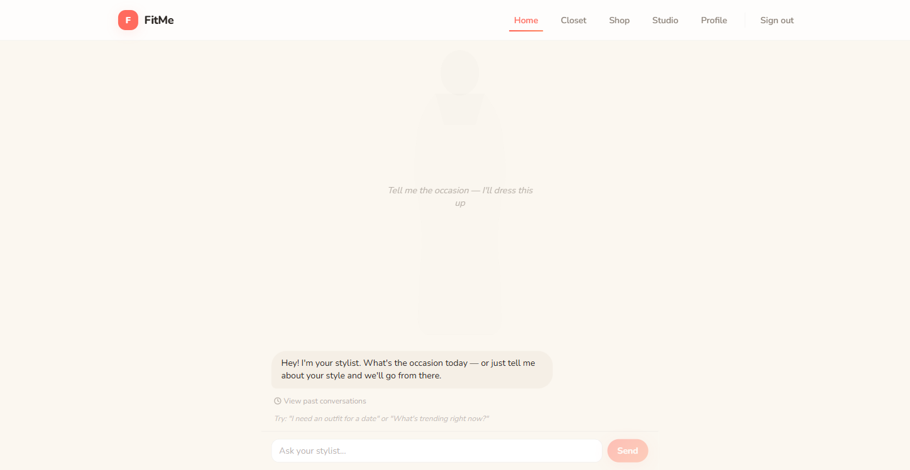
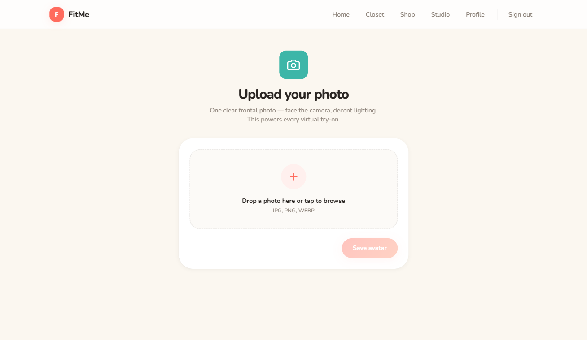
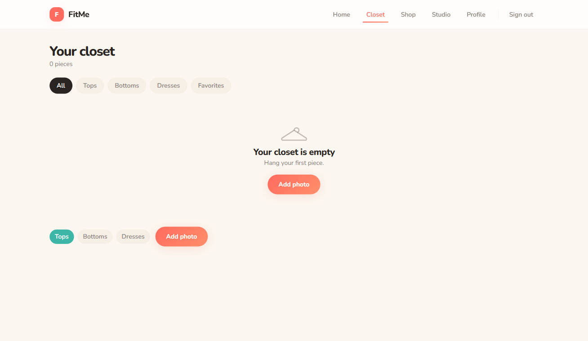
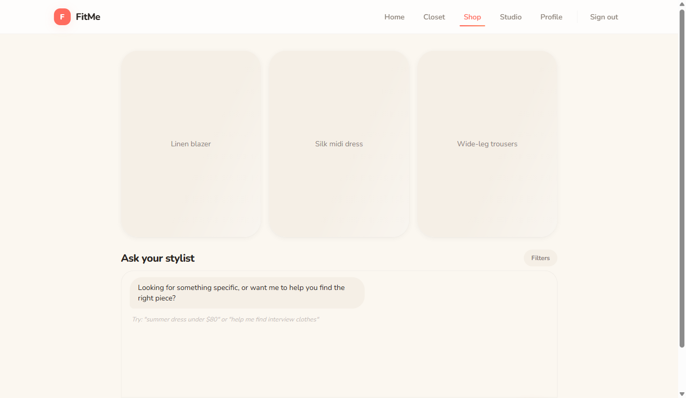
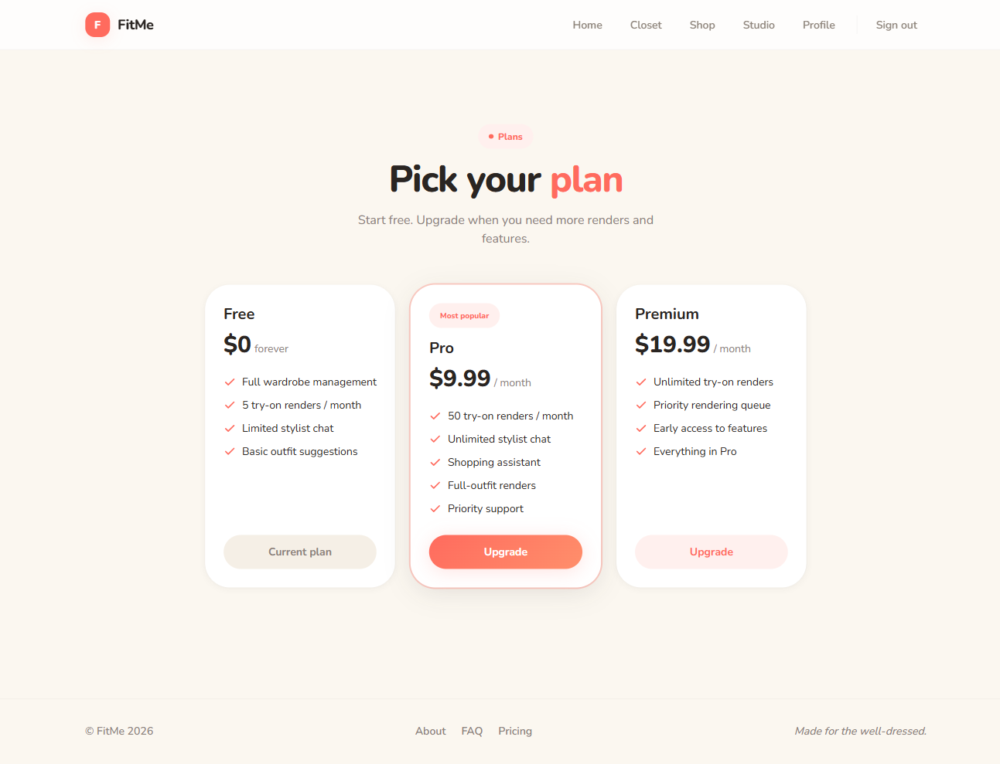

# VestoFit — AI Stylist & Virtual Try-On

VestoFit is a fashion-tech app that combines an AI stylist, a virtual wardrobe, photorealistic virtual try-on, and AI-assisted shopping — all driven by natural conversation.

- **Mobile app** (`mobile/`) — Expo / React Native. **This is the production surface.**
- **Backend API** (`backend/`) — FastAPI + PostgreSQL, serves the mobile app (and the web demo).
- **Web demo** (`frontend/`) — Next.js. Development/demo surface only; it does not ship to production.

<p align="center">
  
  
</p>

---

## Features

- **AI Stylist** — Chat about an occasion or your style. The stylist knows your wardrobe, suggests complete outfits, builds a style profile, and can re-roll suggestions.
- **Virtual Try-On** — Try a garment from a product URL or an uploaded photo, or render a full outfit, on your own avatar. Powered by FAL.ai try-on models (Kling Kolors by default).
- **Smart Wardrobe** — Photograph your clothes; the AI auto-tags category, color, pattern, formality, and season. Backgrounds are removed automatically.
- **AI Shopping** — Describe what you need ("summer dress under $80"). The assistant runs a grounded search (location-aware, cached) or asks clarifying questions first.
- **Accounts** — JWT auth, email verification, password reset, account deletion, rate limiting.
- **Plans & quotas** — Render quotas per plan, LemonSqueezy checkout and webhooks.

---

## Architecture

```
┌──────────────────────┐        ┌───────────────────────────┐
│ mobile/ (Expo, RN)   │──HTTP──▶                           │──▶ PostgreSQL 16
│ production client    │        │  backend/ (FastAPI)       │
└──────────────────────┘        │  auth · wardrobe · stylist│──▶ Gemini (LLM: tagging, stylist, shopping)
┌──────────────────────┐        │  tryon · outfits · shop   │──▶ FAL.ai (try-on, avatar editing)
│ frontend/ (Next.js)  │──HTTP──▶  billing · settings       │──▶ Local disk or Cloudflare R2
│ web demo only        │        │                           │──▶ LemonSqueezy, SMTP (optional)
└──────────────────────┘        └───────────────────────────┘
```

| Layer | Technology |
|-------|-----------|
| Mobile | Expo SDK 54, React Native 0.81, Expo Router, TanStack Query, Reanimated 4, Unistyles |
| Backend | FastAPI, SQLAlchemy 2 (async), asyncpg, Pydantic 2 |
| AI | Gemini 2.5 Flash-Lite (tagging, stylist, shopping), FAL.ai (try-on, Flux Kontext avatar edits), rembg, OpenCV |
| Web demo | Next.js 14, React 18, Tailwind, Framer Motion, GSAP, React Three Fiber, Lenis |
| Infra | Docker Compose, PostgreSQL 16, Cloudflare R2 (optional) |

---

## Getting started

### Prerequisites

- Docker Desktop (recommended), or Python 3.11 + Node 20 + PostgreSQL 16
- API keys:
  - **FAL.ai** — https://fal.ai/dashboard/keys
  - **Gemini** — https://aistudio.google.com/apikey

### 1. Configure the backend

```bash
cp backend/.env.example backend/.env
```

Set at least:

```
FAL_KEY=<your-fal-key>
GEMINI_API_KEY=<your-gemini-key>
JWT_SECRET_KEY=<any-long-random-string>
```

All other options (storage, billing, SMTP, model choices) are documented inline in [`backend/.env.example`](backend/.env.example).

### 2. Run the backend (Docker)

```bash
docker compose up --build
```

- API: http://localhost:8000
- Interactive docs: http://localhost:8000/docs
- Web demo: http://localhost:3000

The first build takes a few minutes (Playwright and model downloads).

<details>
<summary>Run without Docker</summary>

```bash
cd backend
python -m venv .venv
source .venv/bin/activate        # Windows: .venv\Scripts\Activate.ps1
pip install -r requirements.txt
python -m playwright install chromium
uvicorn app.main:app --reload
```

Point `DATABASE_URL` in `backend/.env` at your local PostgreSQL.

</details>

### 3. Run the mobile app

The app uses native modules (Unistyles), so it needs a **development build** — Expo Go will not work.

```bash
cd mobile
npm install
cp .env.example .env
npm run android      # or: npm run ios
```

Set `API_URL` in `mobile/.env` to a backend address reachable from the device:

| Target | `API_URL` |
|--------|-----------|
| iOS simulator | `http://localhost:8000` |
| Android emulator | `http://10.0.2.2:8000` |
| Physical device | `http://<your-LAN-IP>:8000` |

### 4. Run the web demo (optional)

```bash
cd frontend
npm install
npm run dev
```

---

## Testing

```bash
# Backend
cd backend && pip install -r requirements-dev.txt && pytest

# Mobile
cd mobile && npm test && npm run typecheck && npm run lint
```

---

## API overview

Full, live schema at `/docs` when the backend is running.

| Area | Endpoints |
|------|-----------|
| Auth | `POST /auth/register`, `/auth/login`, `/auth/forgot`, `/auth/reset`, `/auth/verify/request`, `/auth/verify` · `GET/PATCH /auth/me` |
| Avatar | `POST /avatar/upload` · `GET/DELETE /avatar/me` |
| Wardrobe | `GET/POST /wardrobe/items` · `GET/PATCH/DELETE /wardrobe/items/{id}` · `POST /wardrobe/items/{id}/retag` |
| Stylist | `POST /stylist/chat`, `/stylist/suggest`, `/stylist/reroll` · `GET /stylist/messages` · `GET/PUT/DELETE /stylist/profile` · `POST /stylist/profile/analyze` |
| Outfits | `GET/POST /outfits` · `GET /outfits/{id}` · `POST /outfits/{id}/render` |
| Try-on | `POST /tryon/url`, `/tryon/upload`, `/tryon/outfit` · `GET /tryon/{job_id}`, `/tryon/history` |
| Shopping | `POST /shopping/search`, `/shopping/ask` · `GET /shopping/history` |
| Billing | `POST /billing/checkout`, `/billing/webhook` · `GET /billing/subscription`, `/billing/usage` |
| Settings | `PUT /settings/password` · `DELETE /settings/history`, `/settings/account` |
| Files | `GET /files/{key}` (local storage mode) |

---

## Configuration notes

**Storage** — `STORAGE_BACKEND=local` (default) stores files in `backend/.storage` and serves them at `/files/<key>`. Set `STORAGE_BACKEND=r2` plus the `R2_*` variables to use Cloudflare R2.

**Try-on model** — `FAL_TRYON_MODEL` selects the FAL model:

- `fal-ai/kling/v1-5/kolors-virtual-try-on` — default, best identity preservation
- `fal-ai/fashn/tryon/v1.6` — complex fabrics
- `fal-ai/cat-vton` — non-standard poses
- `fal-ai/image-apps-v2/virtual-try-on` — cheaper, 4K output
- `fal-ai/leffa` — fast

**LLM** — `LLM_MODEL` defaults to `gemini-2.5-flash-lite`.

**Email** — Without SMTP settings, verification and reset links are logged to the backend console.

---

## Project layout

```
VTO/
├── backend/            FastAPI app
│   ├── app/
│   │   ├── routers/    HTTP endpoints
│   │   ├── services/   Business logic (LLM, try-on, shopping, quotas, storage, email)
│   │   ├── models/     SQLAlchemy models
│   │   └── schemas/    Pydantic schemas
│   └── tests/          pytest suite
├── mobile/             Expo app (production client)
│   ├── app/            Expo Router screens: (auth), (onboard), (tabs), settings, pricing…
│   ├── src/            features, components, lib, theme
│   └── __tests__/      Jest tests
├── frontend/           Next.js web demo
├── docs/               Design specs, implementation plans, screenshots
└── docker-compose.yml  Postgres + backend + web demo
```

---

## Screenshots (web demo)

| Wardrobe | Shop | Pricing |
|---|---|---|
|  |  |  |
